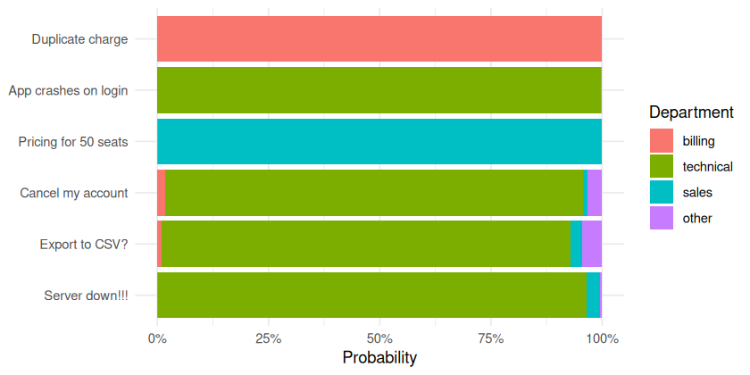

layaR has no tidyverse dependency, but its outputs are ordinary data
frames, factors and lists, so they fit into a dplyr pipeline without any
glue. This article repeats the workflows of
`vignette("data-frames", package = "layaR")` in tidyverse style: annotate a
tibble in a pipe, summarise the answers, unpack the probability
list-columns, and turn batch results into tidy tables.


``` r
library(layaR)
library(dplyr)
library(tidyr)
library(purrr)
library(ggplot2)
```


``` r
questions <- laya_questions(
  department = laya_choice(
    "Which department should handle this request?",
    billing   = "invoices, payments, refunds",
    technical = "bugs, outages, system errors",
    sales     = "pricing, new contracts",
    other     = "everything else"
  ),
  urgency = laya_score("How urgent is this request?",
                       c("not urgent", "soon", "critical deadline or blocking issue")),
  churn_risk = laya_noul("Does the customer say they will cancel or leave?")
)

tickets <- tibble(
  id = 1:6,
  subject = c("Duplicate charge", "App crashes on login", "Pricing for 50 seats",
              "Cancel my account", "Export to CSV?", "Server down!!!"),
  body = c(
    "We were billed twice for March. Refund it or we cancel.",
    "Since the last update the app closes as soon as I log in.",
    "We're a team of 50 and want a quote for the annual plan.",
    "Your service has been unreliable for months. Please close my account.",
    "Is there a way to export my reports to CSV?",
    "Production is down and our customers can't check out. Fix this now."
  )
)
```

## Annotating in a pipe

`laya_annotate()` takes the data first, so it drops straight into a pipe. A
tibble goes in and a tibble comes out, with the answers added as columns:


``` r
annotated <- tickets |>
  laya_annotate(questions, state = c("subject", "body"))

annotated |> select(-subject, -body)
#> # A tibble: 6 × 7
#>      id department department_confidence urgency urgency_confidence churn_risk
#>   <int> <fct>                      <dbl>   <dbl>              <dbl>      <dbl>
#> 1     1 billing                    1        1.84              0.586     0.600 
#> 2     2 technical                  0.987    1.83              0.572     0.504 
#> 3     3 sales                      0.994    1.61              0.305     0.0227
#> 4     4 technical                  0.791    1.84              0.593     0.988 
#> 5     5 technical                  0.746    1.65              0.348     0.0034
#> 6     6 technical                  0.875    1.93              0.776     0.98  
#> # ℹ 1 more variable: churn_risk_confidence <dbl>
```

`state` takes the column names as strings (`c("subject", "body")`), not bare
names: write `state = c("subject", "body")`, not `state = c(subject, body)`.

A choice question gives a factor whose levels are the options in order, so
`count()` keeps them in that order. Add `.drop = FALSE` to show options no
row chose:


``` r
annotated |> count(department, .drop = FALSE)
#> # A tibble: 4 × 2
#>   department     n
#>   <fct>      <int>
#> 1 billing        1
#> 2 technical      4
#> 3 sales          1
#> 4 other          0
```

A yes/no answer is a probability, so filtering on it is a threshold:


``` r
annotated |>
  filter(churn_risk > 0.5) |>
  arrange(desc(churn_risk)) |>
  select(id, subject, churn_risk)
#> # A tibble: 4 × 3
#>      id subject              churn_risk
#>   <int> <chr>                     <dbl>
#> 1     4 Cancel my account         0.988
#> 2     6 Server down!!!            0.98 
#> 3     1 Duplicate charge          0.600
#> 4     2 App crashes on login      0.504
```

And the usual grouped summaries work:


``` r
annotated |>
  group_by(department) |>
  summarise(tickets = n(),
            mean_urgency = mean(urgency),
            at_risk = sum(churn_risk > 0.5))
#> # A tibble: 3 × 4
#>   department tickets mean_urgency at_risk
#>   <fct>        <int>        <dbl>   <int>
#> 1 billing          1         1.84       1
#> 2 technical        4         1.82       3
#> 3 sales            1         1.61       0
```

## Unpacking the probabilities

`probabilities = TRUE` adds an `<id>_probabilities` list-column per
question, each element a named numeric vector. `tidyr::unnest_wider()`
spreads one into a column per option:


``` r
with_probs <- tickets |>
  laya_annotate(questions, state = c("subject", "body"), probabilities = TRUE)

with_probs |>
  select(id, department_probabilities) |>
  unnest_wider(department_probabilities)
#> # A tibble: 6 × 5
#>      id billing technical  sales  other
#>   <int>   <dbl>     <dbl>  <dbl>  <dbl>
#> 1     1  1         0      0      0     
#> 2     2  0.0003    0.998  0.0003 0.0017
#> 3     3  0.0005    0.0001 0.999  0.0004
#> 4     4  0.0184    0.939  0.0091 0.0338
#> 5     5  0.0087    0.92   0.0254 0.046 
#> 6     6  0.0008    0.963  0.0319 0.0039
```

A score question has one column per level, and a yes/no question has
`false` and `true`:


``` r
with_probs |>
  select(id, urgency_probabilities) |>
  unnest_wider(urgency_probabilities)
#> # A tibble: 6 × 4
#>      id `not urgent`   soon `critical deadline or blocking issue`
#>   <int>        <dbl>  <dbl>                                 <dbl>
#> 1     1       0.0071 0.145                                  0.848
#> 2     2       0.0065 0.156                                  0.838
#> 3     3       0.0327 0.328                                  0.639
#> 4     4       0.004  0.149                                  0.847
#> 5     5       0.025  0.298                                  0.678
#> 6     6       0.0024 0.0607                                 0.937
```

`unnest_longer()` gives one row per option instead, the shape grouped
summaries and plots want:


``` r
with_probs |>
  select(id, department_probabilities) |>
  unnest_longer(department_probabilities, indices_to = "option",
                values_to = "probability")
#> # A tibble: 24 × 3
#>       id option    probability
#>    <int> <chr>           <dbl>
#>  1     1 billing        1     
#>  2     1 technical      0     
#>  3     1 sales          0     
#>  4     1 other          0     
#>  5     2 billing        0.0003
#>  6     2 technical      0.998 
#>  7     2 sales          0.0003
#>  8     2 other          0.0017
#>  9     3 billing        0.0005
#> 10     3 technical      0.0001
#> # ℹ 14 more rows
```

## Abstaining on uncertain rows

`min_confidence` compares its threshold with the confidence in each answer
given (for a choice question, the chosen option's probability) and adds an
`<id>_abstained` column. `answer_confidence = TRUE` adds the number it
compared:


``` r
gated <- tickets |>
  laya_annotate(questions["department"], state = c("subject", "body"),
                min_confidence = 0.99, answer_confidence = TRUE)

gated |>
  select(id, department, department_answer_confidence, department_abstained)
#> # A tibble: 6 × 4
#>      id department department_answer_confidence department_abstained
#>   <int> <fct>                             <dbl> <lgl>               
#> 1     1 billing                           1     FALSE               
#> 2     2 technical                         0.998 FALSE               
#> 3     3 sales                             0.999 FALSE               
#> 4     4 technical                         0.939 TRUE                
#> 5     5 technical                         0.92  TRUE                
#> 6     6 technical                         0.963 TRUE
```

The answer is kept even when the model abstains, so you choose what to do
with uncertain rows, for example send them to a person:


``` r
gated |>
  mutate(route = if_else(department_abstained, "human review", as.character(department))) |>
  count(route)
#> # A tibble: 4 × 2
#>   route            n
#>   <chr>        <int>
#> 1 billing          1
#> 2 human review     3
#> 3 sales            1
#> 4 technical        1
```

## Batch results as tidy tables

`laya_predict_batch()` returns a list of full results, one per state.
`as.data.frame()` turns it into a long table with one row per state and
question, and `laya_probabilities()` gives one row per option. Both are
plain data frames; `as_tibble()` makes them tibbles.


``` r
batch <- laya_predict_batch(tickets |> select(subject, body), questions, progress = FALSE)

long <- as_tibble(as.data.frame(batch))
long
#> # A tibble: 18 × 9
#>    state_id id         type   answer    value confidence answer_confidence act_probability
#>       <int> <chr>      <chr>  <chr>     <dbl>      <dbl>             <dbl>           <dbl>
#>  1        1 department choice billing  1           1                 1                   1
#>  2        1 urgency    score  1.84     1.84        0.586             0.848               1
#>  3        1 churn_risk noul   TRUE     0.600       0.600             0.600               1
#>  4        2 department choice technic… 0.998       0.987             0.998               1
#>  5        2 urgency    score  1.83     1.83        0.572             0.838               1
#>  6        2 churn_risk noul   TRUE     0.504       0.504             0.504               1
#>  7        3 department choice sales    0.999       0.994             0.999               1
#>  8        3 urgency    score  1.61     1.61        0.305             0.639               1
#>  9        3 churn_risk noul   FALSE    0.0227      0.977             0.977               1
#> 10        4 department choice technic… 0.939       0.791             0.939               1
#> 11        4 urgency    score  1.84     1.84        0.593             0.847               1
#> 12        4 churn_risk noul   TRUE     0.988       0.988             0.988               1
#> 13        5 department choice technic… 0.92        0.746             0.92                1
#> 14        5 urgency    score  1.65     1.65        0.348             0.678               1
#> 15        5 churn_risk noul   FALSE    0.0034      0.997             0.997               1
#> 16        6 department choice technic… 0.963       0.875             0.963               1
#> 17        6 urgency    score  1.93     1.93        0.776             0.937               1
#> 18        6 churn_risk noul   TRUE     0.98        0.98              0.98                1
#> # ℹ 1 more variable: abstention <chr>
```

`answer` is text, so answers of every type fit in one column; `value` is
the number behind it (for a choice question, the chosen option's
probability). `pivot_wider()` turns the long table into one row per state:


``` r
long |>
  select(state_id, id, answer) |>
  pivot_wider(names_from = id, values_from = answer)
#> # A tibble: 6 × 4
#>   state_id department urgency churn_risk
#>      <int> <chr>      <chr>   <chr>     
#> 1        1 billing    1.84    TRUE      
#> 2        2 technical  1.83    TRUE      
#> 3        3 sales      1.61    FALSE     
#> 4        4 technical  1.84    TRUE      
#> 5        5 technical  1.65    FALSE     
#> 6        6 technical  1.93    TRUE
```

The per-option table is the right shape for ggplot2:


``` r
laya_probabilities(batch) |>
  filter(id == "department") |>
  mutate(option = factor(option, levels = names(questions$department$criteria)),
         ticket = factor(tickets$subject[state_id], levels = rev(tickets$subject))) |>
  ggplot(aes(probability, ticket, fill = option)) +
  geom_col(position = position_stack(reverse = TRUE)) +
  scale_x_continuous(labels = scales::percent) +
  labs(x = "Probability", y = NULL, fill = "Department") +
  theme_minimal()
```



## Working with result lists using purrr

Each result is a list, so purrr's typed maps pull out single values. This
is the tidyverse version of the `sapply()` / `vapply()` code in the other
vignettes:


``` r
batch |> map_dbl(\(r) r$answers$churn_risk$noul)
#> [1] 0.6004 0.5041 0.0227 0.9880 0.0034 0.9800
batch |> map_chr(\(r) r$answers$department$choice)
#> [1] "billing"   "technical" "sales"     "technical" "technical" "technical"
```

A good use is comparing question wordings against a few labelled examples,
as `vignette("writing-questions", package = "layaR")` recommends:


``` r
examples <- tibble(
  text = c(
    "Duplicate charge. We were billed twice for March. Refund it or we cancel.",
    "Your service has been unreliable for months. Please close my account.",
    "Please refund the duplicate today or we will cancel our plan.",
    "Since the last update the app closes as soon as I log in.",
    "We're a team of 50 and want a quote for the annual plan."
  ),
  cancels = c(TRUE, TRUE, TRUE, FALSE, FALSE)
)
wordings <- laya_questions(
  threaten = laya_noul("Does the user threaten to cancel or leave?"),
  say      = laya_noul("Does the customer say they will cancel or leave?"),
  mention  = laya_noul("Does the customer mention cancelling their plan, subscription or account?")
)

scored <- examples |>
  laya_annotate(wordings, state = "text", confidence = FALSE) |>
  pivot_longer(c(threaten, say, mention), names_to = "wording", values_to = "p")

scored |>
  group_by(wording) |>
  summarise(correct = sum((p > 0.5) == cancels),
            min_p_when_true = min(p[cancels]),
            max_p_when_false = max(p[!cancels]))
#> # A tibble: 3 × 4
#>   wording  correct min_p_when_true max_p_when_false
#>   <chr>      <int>           <dbl>            <dbl>
#> 1 mention        4          0.963            0.638 
#> 2 say            5          0.682            0.429 
#> 3 threaten       2          0.0239           0.0109
```

`laya_annotate()` with one question per wording does the same job as the
`sapply()` loop, and the long table makes it easy to score each wording.
